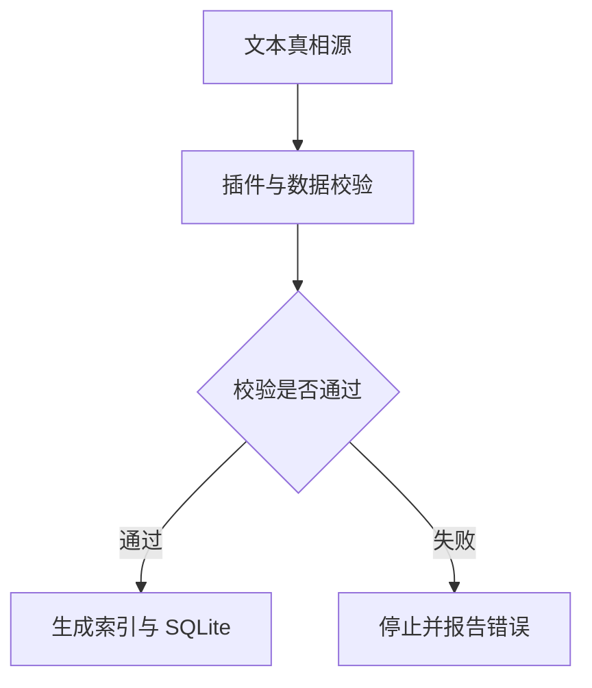

# AI 漫画与轻小说数据项目实现报告

> 单一 GitHub 项目 · 构建期插件 · 本地搜索 · 未来独立 API

## 摘要

- 项目不是人类阅读网站，而是完全开源、供 AI 查询和克隆部署的数据项目。
- 当前只交付一个 GitHub 项目，包含主体、漫画与轻小说两个官方插件，以及可复用搜索核心。
- 文本数据是唯一真相源；索引、静态查询文件和 SQLite 都是可删除、可重建的派生物。
- GitHub 阶段支持静态索引访问与克隆后的本地完整搜索，不支持服务器实时任意查询。
- 未来增加独立 HTTP 搜索 API 时复用同一查询核心，不重写插件和数据格式。

## 一、实现目标与当前状态

项目用于汇总漫画与日本轻小说的作品信息，核心字段包括名称、作者、简介、连载状态和更新进度。主要消费者是 AI，不提供面向人类的阅读界面，也不以网页排版、导航或视觉表现为目标。数据完全开源，其他使用者可以读取、克隆并在本地部署。

| 项目 | 已确认范围 | 明确排除 |
|---|---|---|
| 消费方式 | AI 读取 GitHub 静态数据；克隆后本地查询 | 人类阅读网站、后台管理界面 |
| 内容模块 | 漫画、日本轻小说，二者均为独立插件 | 当前开发评论插件 |
| 维护方式 | 维护者把投稿或更新交给 AI，由 AI 修改数据并构建 | 网站内上传、实时用户写入 |
| 部署方式 | 当前仅 GitHub；未来可独立部署搜索 API | 当前依赖外部数据库或服务器 |
| 远期规模 | 按上万条作品记录设计 | 未经验证的性能承诺 |

本报告是需求讨论和源码调研后的实现基线，不是完工报告。当前尚未创建 GitHub 仓库、编写主体代码、录入真实作品数据或执行基准测试。GitHub 账号和访问凭证也未准备好，因此报告中的命令、目录和接口均为后续实施依据。

## 二、已确认的架构决策

**从"网站"转为"机器可读的数据项目"。** 最初曾考虑 GitHub Pages 与文档生成器，但纯 AI 消费使 HTML 页面失去价值。页面主题、导航和客户端搜索只会增加维护成本，当前架构不再包含这些部分。

**格式选择服从查询链路。** Markdown 对长文本和维护说明仍有价值，但上万条记录的条件筛选必须能由程序完成。作品元数据采用结构化 JSONL；查询结果采用 JSON；Markdown 只用于必要的规范、说明或确实存在的长文本内容，不作为默认搜索响应。

| 方案 | 优势 | 本项目结论 |
|---|---|---|
| 单一大 Markdown 文件 | 自然语言密度高，短文本易读 | 不采用为全量主库；难以稳定进行程序化筛选 |
| JSONL 文本数据 | 逐行解析、便于追加、Git 差异可审查 | 采用为结构化真相源 |
| SQLite 直接入库 | 查询和关联能力强 | 不作为 Git 真相源；作为本地生成物 |
| 文本真相源 + SQLite 派生 | 兼顾可维护性与查询能力 | 采用 |

**模块化采用单仓库，而非多仓库。** 主体、官方内容插件、搜索核心和未来接口契约放在一个仓库中，保证一次克隆即可得到完整系统。模块边界通过目录、契约和构建规则实现，不以拆仓库代替架构设计。

**插件系统只在构建期加载。** 当前不实现运行时热插拔、远程安装、插件市场或第三方任意代码执行。启用插件后必须重新构建；这符合 GitHub 静态分发的能力边界，也降低供应链与维护风险。

## 三、单仓库与插件系统

以下目录是实施目标，不代表现有文件。主体不理解"话数""卷数"等业务差异，只提供插件协议、通用构建、能力注册和查询基础设施。

```text
<repository>/
├── kernel/                    # 插件发现、校验、依赖与生命周期
├── contracts/                 # 数据、插件、查询、错误契约
├── plugins/
│   ├── manga/                 # 官方漫画插件
│   │   ├── plugin.json
│   │   ├── data/
│   │   ├── schemas/
│   │   └── queries/
│   └── light-novel/           # 官方轻小说插件
│       ├── plugin.json
│       ├── data/
│       ├── schemas/
│       └── queries/
├── search/                    # 索引、筛选、分页、SQLite 查询
├── interfaces/
│   ├── capabilities.json      # AI 能力发现
│   └── openapi.json           # 未来 HTTP API 契约
├── tools/                     # 校验、构建与本地查询
├── generated/                 # 派生索引和静态文件
└── .github/workflows/         # 自动校验与构建
```

漫画与轻小说插件可以分别启用、禁用、校验和重建。两者应共享通用的作品记录契约，避免复制标题、作者、状态、标签、来源和更新时间等基础逻辑；各自只扩展进度单位和特有字段。评论未来作为可选插件，通过稳定的作品 ID 建立单向依赖，不向作品记录中嵌入评论正文或评论统计。

| 启用状态 | 预期行为 |
|---|---|
| 无插件 | 主体可完成空构建，能力清单不包含内容查询能力 |
| 仅漫画 | 只生成漫画数据、索引和查询能力 |
| 仅轻小说 | 只生成轻小说数据、索引和查询能力 |
| 两个官方插件 | 两类内容可共存，数据与接口仍保持独立 |
| 启用但插件缺失 | 构建明确失败，不静默跳过 |

插件清单至少包含插件 ID、版本、插件协议版本、依赖和能力声明。构建顺序由依赖关系决定；无依赖插件按 ID 确定顺序，保证相同输入得到一致输出。插件不得修改其他插件的数据，也不得覆盖主体或其他插件的生成结果。

## 四、数据与搜索设计

作品 ID 必须稳定且永不复用。状态使用受控枚举，标签来自受控词表，日期使用 ISO 格式，进度拆成单位和数值。这样可以把"找出某状态、某标签的作品"转化为确定的程序筛选，而不是让 AI 逐条阅读全部数据。

```json
{
  "id": "m-000001",
  "title": "作品名",
  "author": "作者",
  "status": "serializing",
  "progress": {"unit": "chapter", "value": 87},
  "tags": ["fantasy"],
  "synopsis": "作品简介",
  "source": "https://example.invalid/to-be-replaced",
  "updated": "2026-11-24"
}
```

> 说明：以上仅为字段结构示意，`example.invalid` 是保留占位域名，实施时必须替换为真实来源；标签与状态枚举尚未最终冻结。

构建过程只读取真相源，随后生成精简索引、静态详情和本地数据库。索引不得手工维护，否则会出现索引与详情字段不一致。SQLite 文件不提交到仓库，克隆者通过工具重新生成。



> 图 1：构建必须 fail closed，校验失败时不发布残缺索引。

本地搜索由同一查询核心承担：精确筛选使用结构化字段与索引，关键词查询使用独立搜索投影，分页返回稳定游标。静态 GitHub 访问则先读取能力清单，再读取插件索引或分片，最后按 ID 获取详情。没有服务器时，AI 必须自行筛选已取得的索引，或克隆项目后调用本地搜索。

| 能力 | GitHub 静态访问 | 克隆后本地部署 |
|---|---|---|
| 按 ID 获取作品 | 支持预生成文件 | 支持 |
| 按状态、标签等预定义维度 | 支持预生成索引 | 支持 |
| 任意组合条件与关键词 | 需下载索引后由 AI 筛选 | 由搜索核心执行 |
| 服务器实时查询 | 不支持 | 未来 HTTP 适配层提供 |

## 五、AIHOT 参考项目调研结论

本次核对了 AIHOT 的架构文档、数据库迁移和公开查询源码。该项目采用 Fastify、React Router、PostgreSQL 和任务进程，是兼顾人类阅读与 Agent 访问的动态应用，并非静态文件搜索。[1]

其数据库将原始文章、AI 处理结果、公开读取投影和搜索表分开。`publications` 是网页和 API 共用的公开读取层，`pool_search` 只保存搜索所需文本，避免每次扫描完整文章。公开内容变化还写入同步账本，支持快照与增量更新。[2]

搜索使用 PostgreSQL `pg_trgm` 和 GIN 索引。查询会转义通配符、拆分关键词，并区分标题摘要与正文；短词可以扫描窄搜索表，长词利用三元组索引。相关度排序采用规则加权，另有搜索并发限制和相同查询合并机制。[3][4]

AIHOT 对程序提供版本化 JSON API 和游标分页，对 Agent 提供基于同一查询结果的 Markdown 地址。由此可借鉴的是"统一查询语义、多种输出"，而不是本项目也必须输出 Markdown。由于本项目完全面向 AI，默认保留 JSON 即可。[5][6]

| 借鉴 | 不照搬 |
|---|---|
| 统一公开查询层 | React 网站、RSS、页面路由和后台界面 |
| 独立搜索投影 | PostgreSQL、多进程采集与写作系统 |
| 版本化接口、游标与结构化错误 | 面向人类的 Markdown 回答提示 |
| 显式模块插口和模块自有迁移 | 与当前需求无关的向量事件归组 |

## 六、分阶段实施与验收

| 阶段 | 主要交付 | 验收条件 |
|---|---|---|
| P0：冻结契约 | 作品字段、状态与标签枚举、插件清单、查询与错误格式 | 示例数据通过 Schema 校验；字段含义无双重解释 |
| P1：主体与官方插件 | 加载器、依赖解析、能力清单、漫画与轻小说插件骨架 | 无插件、单插件、双插件及缺失插件场景均符合预期 |
| P2：本地搜索 | SQLite 生成、精确筛选、关键词查询、稳定分页 | 同一输入可重复构建；查询结果与真相源一致 |
| P3：GitHub 静态出口 | 能力清单、插件索引、按 ID 详情、自动校验工作流 | 固定 URL 可读；校验失败不会发布部分结果 |
| P4：未来在线 API | 独立 HTTP 适配层与部署配置 | 复用搜索核心；不改变数据与插件契约 |

第一阶段不应同时开发评论插件、通用全文搜索、向量检索或在线动态服务。先让两个同构但独立的官方插件跑通，可以验证抽象是否过度；评论这种关系型扩展出现后，再检验现有插件扩展点是否足够。

上万条是设计容量目标，不是已经验证的性能结论。实施时需要使用接近真实字段长度和标签分布的测试数据进行构建耗时、查询延迟、索引体积和 Git 差异检查，不能用理论估计替代实测。

## 七、风险、边界与待确认项

| 事项 | 影响与处理 |
|---|---|
| GitHub 静态托管限制 | 不能处理实时任意查询；未来动态 API 必须单独部署 |
| 插件系统过度抽象 | 先限定本地、构建期、声明式插件；以两个官方插件验证，不承诺任意未来插件零改主体 |
| 索引双写不一致 | 索引全部由真相源生成，不提供手改入口 |
| 标签和状态失控 | P0 冻结受控词表与迁移规则，后续变更加版本记录 |
| 外部投稿与提示注入 | 投稿只作为数据处理，不执行其中指令；保留来源并按需要核对 |
| 版权与来源 | 只保存作品元数据与必要简介，不收录漫画或小说正文；来源字段规则待确认 |
| 公开仓库可见性 | 公开数据无法物理禁止人类查看；"不服务人类"不等于访问控制 |

在正式编码前仍需确认：GitHub 用户名与仓库名、实现语言、作品字段最终清单、状态与标签词表、来源链接采用聚合站还是作品官网、第一批静态查询维度，以及 GitHub Actions 生成物的发布方式。账号和 Token 只影响后续推送，不妨碍先冻结上述契约。

下一步应从 P0 开始，而不是直接搭建页面或在线服务。优先产出机器可校验的 Schema、插件清单规范、查询契约和最小样例数据，再进入主体实现。

## 参考资料

1. AIHOT 架构文档：github.com/KKKKhazix/AIHOT/blob/main/docs/architecture.md
2. 核心数据库迁移：github.com/KKKKhazix/AIHOT/blob/main/database/migrations/0001_core.sql
3. 搜索表与索引：github.com/KKKKhazix/AIHOT/blob/main/database/migrations/0014_pool_search.sql
4. 搜索查询实现：github.com/KKKKhazix/AIHOT/blob/main/packages/backend/src/publication/pool.ts
5. 公开 API 与游标查询：github.com/KKKKhazix/AIHOT/blob/main/packages/backend/src/publication/v1.ts
6. Agent 输出实现：github.com/KKKKhazix/AIHOT/blob/main/packages/backend/src/publication/agent.ts

> 调研范围：上述公开源码与本文讨论记录。未进行 AIHOT 部署实测，也未对本项目执行性能测试。
